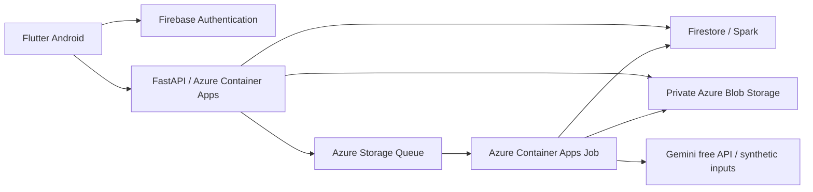

# MediFlow AI MVP specification

Agreed: 2026-10-20  
Planning baseline: one developer, eight weeks, 15–20 hours/week (120–160 hours)  
Budget: ₹0 out of pocket  
Source idea: [docs/agents/idea.md](../../docs/agents/idea.md)

## 1. Project outcome

Build a college demonstration of a hospital document-review workflow, delivered as a signed Android APK with an independently hosted backend.

The mandatory journey is:

**Patient uploads a synthetic laboratory PDF → backend extracts evidence-linked laboratory information → administrator assigns the case → doctor checks and reviews the analysis → patient sees the approved result.**

Every upload creates one case. Processing is asynchronous and continues when the app is closed. The app must work over the internet while the developer's laptop is off. A cold start after inactivity is acceptable and must have a clear UI state.

All patient records, medical documents, doctor activity, and clinical reviews are simulated. This is a document-extraction and workflow demonstration. It does not make diagnoses, prescribe treatment, or establish clinical effectiveness.

## 2. Mandatory scope and exclusions

### Included

- Flutter Android application using Riverpod and GoRouter.
- One hospital, with pre-created patient, doctor, and administrator accounts.
- Firebase email/password authentication and backend-enforced permissions.
- Private, validated PDF uploads and exact-file duplicate detection.
- Digital PDFs and scanned PDFs; native extraction with OCR fallback.
- Structured laboratory rows, page-level evidence, validation issues, and source-grounded summaries.
- Manual case assignment by an administrator.
- Doctor approval, correction and approval, or rejection.
- Patient access to approved results and workflow status.
- Original AI outputs, analysis versions, review history, and server-controlled audit events.
- Durable job processing, two automatic retries for transient failures, and authorized manual retry.
- Configurable upload limits, processing bounds, and retention.
- A synthetic evaluation dataset and reproducible measured results.
- Hosted deployment, signed APK, documentation, and recorded demonstration.

### Deferred

Written radiology reports are a stretch goal only after all laboratory release gates pass and time remains. The mandatory backlog excludes direct radiology image interpretation, multiple hospitals, public signup, appointments, prescriptions, clinical notes/copilot chat, automatic routing, laboratory trend charts, operations dashboards, multilingual support, push notifications, standalone image uploads, handwriting, mixed-language documents, and precise PDF bounding-box highlighting.

Do not add these features by reducing the required authorization, review, job-recovery, or evaluation work.

## 3. Users and authorization

All protected API calls verify the Firebase ID token, active account, server-controlled role, hospital scope, and resource relationship. Never trust patient IDs, role fields, storage paths, assignment, or approval flags supplied by the client.

| Capability | Patient | Doctor | Administrator |
| --- | --- | --- | --- |
| Upload a synthetic report | For self | No | No |
| View workflow status | Own cases | Currently assigned cases | Hospital workflow metadata |
| Read original PDF | Own unexpired reports | Currently assigned cases | No by default |
| Read AI drafts and validation issues | No | Currently assigned cases | No by default |
| Read approved result | Own cases | Currently assigned cases | No by default |
| Assign/reassign a case | No | No | Yes, to active eligible doctors |
| Review or request reprocessing | No | Currently assigned cases | No clinical permission |
| Inspect operational failures | Own safe status | Assigned safe status | Sanitized operational metadata |
| Write clinical/result/audit data directly | No | No | No |

The administrator's list includes opaque case/report IDs, patient identity needed for assignment, department/doctor metadata, status, and timestamps. It excludes PDF contents, extracted rows, summaries, source quotations, and review corrections.

Use one app with role-specific navigation after login. Seed roles through a trusted backend/admin script; users cannot self-promote. Disable public signup flows. Backend code performs all protected record access; Firestore rules deny mobile clients direct clinical reads/writes and all client audit writes. Private Blob access cannot bypass the backend.

Reassignment immediately revokes the former doctor's subsequent API access. The system cannot erase already downloaded content from a device; keep the viewer's cache temporary and clear it on logout/role changes.

## 4. Upload and document contract

- English-language PDFs only, including digital and scanned PDFs.
- Maximum 10 MB (define consistently as 10,000,000 bytes) and 10 pages.
- Validate actual PDF content, page count, readability, encryption/password requirements, and processing bounds. Filename or declared MIME type is insufficient.
- Explicitly reject corrupt, password-protected, unsupported, unreadable, over-size, and over-page-limit files with safe explanations.
- Unsupported document categories, including radiology for the mandatory release, receive a clear unsupported outcome.
- Require a synthetic-data acknowledgement. Do not claim that this acknowledgement or a detector guarantees de-identification.
- Generate report/case IDs and private object paths on the server.
- Reserve an upload, stream its bytes through an authenticated bounded endpoint, then verify the stored object before creating analysis work. A failed or partial upload is retryable without creating another case when the same idempotency key is reused.
- Hash the verified original bytes with SHA-256. Duplicate checks are scoped to the same patient/hospital and unexpired records; never reveal another patient's upload.
- A byte-identical completed upload returns the existing report/case for that patient, without another processing job or another quota charge. Reprocessing is a separate authorized operation.
- Enforce five verified new reports per patient per day and twenty hospital-wide per day, using an explicitly documented UTC daily boundary and atomic counters.
- Bound unfinished upload reservations and clean up abandoned objects. Do not charge a quota slot twice for retries or duplicate completion calls.

Uploads and result retrieval never use public permanent document URLs. The Android viewer receives document bytes through an authenticated backend request; avoid long-lived bearer download links.

## 5. Laboratory output and evidence

Each extracted row contains:

- Test/analyte name as printed.
- Numeric or qualitative result, preserving its original textual representation.
- Printed unit, if present.
- Printed reference interval, if present, preserving inequality/range notation.
- Printed abnormality flag, if present.
- Collection date when explicitly stated, retaining original date text if ambiguous.
- Source page number and supporting quotation.
- Field/row validation issues and review status.

Preserve values such as inequalities, decimal precision, negation in qualitative results, missing units, and absent ranges. Missing information is null/absent with a reason rather than invented. Do not convert units, infer a reference interval, compute a diagnosis, or add treatment advice.

Store page text and its origin (native text or OCR) for evidence verification. Validate evidence page bounds and quotation matching against normalized extracted text while retaining the original text. Matching text proves traceability, not correct medical interpretation or correct table-row association. OCR output may itself be wrong; reviewers must be able to inspect the original page.

Use schema-constrained AI output and deterministic validation for types, numeric syntax, source/page consistency, and detectable discrepancies. Do not claim deterministic checks can prove absence of all unsupported claims or semantic errors. Low-quality, missing, and conflicting information remains visibly flagged.

Summaries describe extracted document content only. Prefer summaries generated from structured, source-linked fields; any free-text model output must meet the same evidence/review requirements. Do not display invented extraction-confidence percentages.

The doctor can open a PDF page from each row. Use tabs on narrow screens and a split view where space permits. Bounding-box highlighting is optional.

## 6. Processing, assignment, and review lifecycle

Keep separate state dimensions:

| Dimension | States/representation |
| --- | --- |
| Document processing | upload_pending → validating → queued → processing → succeeded; failed or rejected where applicable |
| Assignment | assignedDoctorId is absent or identifies a currently eligible doctor |
| Analysis review | not_ready → pending → under_review → approved or rejected |
| Retention | expiresAt controls access independently of processing/review state |

A file/document rejection is different from a doctor's rejection of an analysis. Display clear labels such as uploading, processing, awaiting assignment, awaiting review, under review, approved, rejected, failed, or expired based on these dimensions. These statuses convey workflow, never clinical severity.

Each accepted upload creates one report and one case. Each processing run creates a new immutable analysis candidate linked to its report, job, schema, prompt, pipeline, provider, and model versions.

The durable job record is authoritative. Queue delivery is at least once; duplicate messages must not duplicate analysis versions, review records, notifications, counters, or audit transitions. Handle a crash between persisting a job and enqueueing it, and between saving results and acknowledging the queue message. A bounded recovery mechanism finds undispatched jobs and expired execution leases.

Transient provider/network failures get at most two automatic retries after the initial attempt. Retry attempts have backoff, deadlines, and attempt records. Invalid/unsupported documents do not enter automatic retry loops. Set finite, configurable upload, OCR, LLM-call, and job timeouts and benchmark their values; no nested retry loop may bypass the three-attempt ceiling.

A doctor assigned to the case may request a manual retry/reprocessing, subject to permissions and rate limits. Repeated requests with the same idempotency key return the same operation.

Review uses optimistic concurrency against the requested analysis version. The doctor may:

1. Approve an analysis with no unresolved blocking issue.
2. Correct fields and approve, preserving original AI values and the correction/evidence history.
3. Explicitly mark an issue unresolved with a reason and approve the resulting qualified record.
4. Reject with a reason.

Do not permit silent approval of flagged fields. Explicit unresolved acknowledgement must be distinguishable from verified/corrected data. Require correction evidence where the field is presented as source-derived.

Store reviews as append-only decisions; never overwrite the AI candidate or previous review history. Repeated submission is idempotent, and a stale doctor's screen cannot overwrite a newer assignment/review.

A patient sees processing/review status before approval, but no AI draft. After approval, show the approved snapshot with unresolved qualifications and review attribution. Rejection displays a safe status/message rather than exposing the draft.

When an approved report is reprocessed, retain its approved snapshot until the replacement is separately approved. Rejected or failed replacement analyses do not silently remove the previously approved snapshot. Retention expiry still applies.

## 7. Application journeys

### Patient

Sign in → acknowledge synthetic-only demonstration → upload a PDF → see progress and meaningful errors → reopen and recover persisted status → view approved rows, summary, review attribution, and original PDF.

### Doctor

Sign in → view assigned cases → open original evidence and AI rows → inspect flags → correct/qualify/approve or reject → view recorded decision → request authorized reprocessing when necessary.

### Administrator

Sign in → view pending/assigned case statuses and active doctor metadata → assign/reassign → inspect sanitized processing failures. Clinical documents and AI drafts remain inaccessible.

Use in-app refresh/polling only. Stop polling when screens are inactive and refresh authoritative state on resume. Show a useful backend-starting message for cold starts. Closing the app must not cancel an accepted processing job. An expired session requires login without exposing cached clinical content.

## 8. Hosting and system boundaries

### Application modules

- Flutter presentation and Riverpod controllers depend on repository/API interfaces.
- Backend authorization is shared across upload, result, evidence, assignment, review, and retry endpoints.
- Document processing accepts a private source artifact and returns versioned candidate data and evidence; it does not approve records.
- The AI provider interface isolates credentials, model configuration, rate errors, and structured output from workflow logic.
- A review operation owns review concurrency, audit events, and the patient-visible approved snapshot.
- Storage and job adapters isolate Azure-specific implementation from the processing domain.

### Hosted resources

Use Azure Container Apps Consumption for the API, initially minimum zero and maximum one replica, with bounded-concurrency event-driven jobs for OCR/AI work. Persist originals/artifacts in private Blob Storage and work delivery in Storage Queue. Keep authoritative records/results/reviews in Firestore, rather than relying on ephemeral container files.

Firebase Storage is replaced because its live service requires a billing-enabled plan. Firebase Spark Auth/Firestore remain subject to their no-cost quotas. Do not enable paid Firebase upgrades.

Use Azure student spending protection; no pay-as-you-go conversion or separately billed Marketplace add-ons. Registry, storage, queue operations, logs, networking, and non-free compute can consume student credit. An alert is not a hard spending cap. Verify actual regional quota and student eligibility before relying on this architecture.

Gemini Free Tier is the initial provider for synthetic documents. Select the current available model through a small extraction benchmark rather than hardcoding an unverified model name into this plan. Keep keys server-side. On quota exhaustion, persist a clear unavailable/rate-limited state; never replace a real result with a canned/fabricated one or silently use paid inference.

All services must be internet-reachable through authenticated HTTPS without local tunnels or a running laptop. Hosting can stop when student credit/eligibility expires; document renewal/export and redeployment. This project does not promise perpetual free availability.

### Early feasibility gate

Ticket 01 verifies Azure student activation, an allowed region, Container Apps API/job quotas, private Blob access, queue operation, HTTPS access from an Android device, and a cost estimate for all resource categories. The user has GitHub Education access. At planning time Azure activation was unverified; ticket 01 now records verified student credit and the remaining account-specific checks.

If this gate fails, preserve the hosted/laptop-independent and ₹0 requirements. Record the actual constraint and propose a verified no-cost alternative; do not silently switch to local-only operation, add paid billing, or promise unsupported capacity.

## 9. Data and API contracts

Use server-controlled records for users, doctors, patients, reports, cases, processingJobs, analyses, reviews, auditEvents, and quota/dispatch bookkeeping. Include hospitalId where needed for scope, even though onboarding multiple hospitals is deferred.

Report records link patient, case, original artifact, hash, timestamps, expiry, processing state, latest analysis, and approved snapshot. Analysis records retain extracted fields, evidence, validation, attempt/version identifiers, and creation time. Reviews retain reviewer, decision, changes, unresolved acknowledgements, analysis ID/version, and time. Avoid ever-growing embedded history arrays; use separate records/pagination.

Keep initial endpoints under /api/v1:

| Operation | Endpoint |
| --- | --- |
| Current authorized account | GET /me |
| Register one report/case | POST /reports |
| Stream bounded PDF bytes | PUT /reports/{reportId}/file |
| Verify upload and enqueue idempotently | POST /reports/{reportId}/complete-upload |
| Get authorized metadata/status | GET /reports/{reportId} |
| Get permitted analysis/approved result | GET /reports/{reportId}/result |
| Stream original PDF with authorization | GET /reports/{reportId}/document |
| Request new processing attempt | POST /reports/{reportId}/reprocess |
| Record version-specific review | POST /reports/{reportId}/review |
| List permitted cases | GET /cases |
| List doctors for authorized assignment | GET /doctors |
| Assign/reassign eligible doctor | POST /cases/{caseId}/assignment |

Define concrete Pydantic/OpenAPI contracts and corresponding Dart models in ticket 02. List APIs are paginated. Error responses use stable codes and request IDs, without exposing private data, infrastructure credentials, or raw provider responses. Distinguish unauthenticated, denied, expired, invalid upload, quota exhausted, conflict, and temporary processing failures.

The API always determines which result version a caller may see. A patient cannot request an arbitrary draft analysis ID to bypass approval.

## 10. Security, retention, and resource controls

- Protect every record/document operation server-side; use deny-by-default Firestore and Blob policies.
- Treat PDF text as untrusted data, including embedded instructions. The model has no tools, unrestricted database access, or authority to write approved records.
- Bound PDF rendering resolution, page count, memory/concurrency, provider tokens, queue attempts, and job runtime.
- Store no credentials in the APK, repo, logs, or recorded demo. Restrict worker/cloud identities to their required resources.
- Audit upload, processing state/result creation, assignment, review, reprocessing, document-access grant/read attempts, denial, and expiry using server timestamps and actor/resource/version references.
- Do not log full PDFs, extracted medical text, tokens, provider keys, or complete model payloads. Administrator diagnostics expose sanitized error codes.
- Enforce expiresAt = verified upload time + 30 days. Deny expired content immediately even if physical cleanup is delayed.
- Cleanup removes original PDFs, generated artifacts, analysis content, approved snapshots and related review payloads; it also prevents queued/retried work from recreating expired content.
- Keep a minimal expiry event containing opaque IDs, time, and outcome without the removed clinical payload. Apply a documented 30-day rolling retention to minimal audit events.
- Bound orphan upload lifetime, total stored bytes, reprocessing frequency, and audit/log volume. Set and document conservative initial values after the hosting spike; they supplement the agreed upload caps.
- Retention/cost cleanup uses trusted scheduled processing; do not enable paid Firestore TTL features.
- Keep a repeatable synthetic seed/reset/export procedure. The demo must be recoverable without real patient data.

## 11. Evaluation and release acceptance

### Dataset

Create 40 synthetic PDFs with independently authored expected annotations:

- 20 development examples: ten digital and ten scanned.
- 10 valid held-out examples: five digital and five scanned, unseen during prompt tuning.
- 10 negative cases: corrupt/unreadable files, unsupported document category/language, password protection, and size/page-limit failures.

Cover numeric and qualitative results, missing units/ranges, decimal formatting, inequalities, repeated analytes, printed flags, dates, multi-page tables, and plausible OCR degradation. The exact negative-case partition and seeds are recorded in the manifest. Render scans from fixture originals with reproducible transformations; expected values come from original fixture specifications, never from model output.

### Extraction target

Target at least 95% exact agreement on complete annotated laboratory rows in the held-out valid set. Define a correct row as matching analyte, result, unit, printed interval, printed flag, applicable collection date, and a valid source page/quotation after documented formatting-only normalization.

Report strict row precision and recall so omitted rows and extra rows cannot inflate agreement; both target at least 95%. Also report per-field scores, sample counts, and separate digital/scanned performance. Do not normalize units, inequalities, values, or clinically meaningful wording merely to improve the score.

Record evidence mismatches, unsupported summary claims, flagged/unresolved output, classification failures, latency, failure rate, provider usage/cost, and consumed/free/student-credit infrastructure resources. Report zero out-of-pocket spend separately from resource charges covered by student credit.

### Required functional checks

- Complete patient → administrator → doctor → patient flow on an installed Android APK.
- Cloud operation with the developer's laptop off and the phone using another network.
- Unauthenticated access, cross-patient access, unassigned/reassigned doctor access, administrator clinical access, direct Firestore/Blob bypass, and draft-analysis access are denied.
- Failed upload, malformed PDF, unavailable provider, cold start, duplicate completion, duplicate queue delivery, worker crash/restart, exhausted retry count, and app reopen behave correctly.
- Review concurrency, corrections, explicit unresolved acknowledgement, rejection, and replacement approval preserve the right versions.
- Expiry denies access and eventually removes artifacts/results without stale jobs recreating them.
- All defined authorization and review-workflow tests pass; no known cross-user exposure or silent review overwrite remains.

The 95% number is a release target, not a measured claim. If it is missed, fix within the timebox or explicitly document the unmet target and limitations; do not tune on the held-out set, hide failures, or relabel the mandatory scope as complete. The small synthetic benchmark does not establish real-world clinical accuracy.

## 12. Final handoff

Deliver a signed release APK, source code, reproducible development/deployment instructions, architecture diagram, OpenAPI/API documentation, synthetic fixtures and evaluation command/results, cost/retention/renewal notes, limitations, and a recorded end-to-end demonstration.

The APK is shared free with classmates/examiners. Target up to twenty authorized devices using Android's free limited-distribution route where required. Google Play publication with a new paid developer account is outside the ₹0 requirement. Preserve the release signing key privately so updates remain installable.

See [roadmap.md](roadmap.md), [decisions.md](decisions.md), and the [ticket index](README.md#implementation-tickets).
